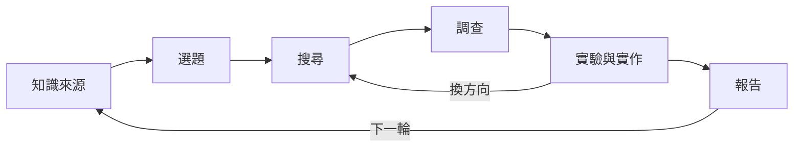

> 本文由 2026-08-13 HackMD 設計筆記於 2026-11-01 擴寫；文中版本資訊以 2026 年 8 月當時的生態為準。

做研究的過程向來是散裝的：RSS 訂閱開在閱讀器、筆記躺在 HackMD、查到的資料是十幾個瀏覽器分頁、實驗在 terminal 裡跑、報告最後手刻 Markdown。每個環節都存在，但環節之間靠人肉搬運。這篇是我在 8 月中寫下的設計筆記擴寫版，目標只有一個——把「知識來源 → 選題 → 搜尋 → 調查 → 實驗 → 報告」整條研究流程變成可以自動跑的 pipeline，而且每個階段都能 loop、能回溯、能換方向。

## 階段一：知識來源與索引

研究系統的第一個瓶頸不是模型，是進料。文件格式就是第一道牆——論文是 PDF、筆記是 docx、規格書是 EPUB。8 月初 [Firecrawl 釋出的 anydoc](https://github.com/firecrawl/anydoc)（MIT 授權）正好補上這塊：純 Rust、單一 document model、14 種格式統一轉成 GFM Markdown，中位數轉換時間低於 5ms，還自帶 agent skill 可以直接掛給 agent 用。比起自己養 pandoc 腳本，這種「所有格式走同一個 serializer」的設計，修一次 bug 全格式受惠。

進料之後要有索引。我的立場明確：這種規模不需要向量資料庫伺服器，[sqlite-vec](https://github.com/asg017/sqlite-vec) 就夠——單一 SQLite 檔、純 C 擴充、跑在任何 SQLite 跑的地方，`vec0` 虛擬表格加 FTS5 全文檢索就能組出 hybrid search。缺點也照實說：它還在 pre-v1，schema 可能破壞性變更，索引要設計成可以隨時重建。

## 階段二：選題與排程

選題靠兩個訊號源：一是 cron——每天固定「幫我看一下 X 領域有什麼新的」，把瀏覽被動化；二是 [GitHub REST API](https://docs.github.com/en/rest)，watch 的 repo 有沒有新 release、某個 label 的 issue 增減，都是現成的題目雷達。排程引擎如果要圖形化，[n8n](https://docs.n8n.io/) 在 2026 年 8 月已經到 2.x 系列，AI agent 節點和 human-in-the-loop 工具審核都內建；但自架 cron + 幾支腳本其實更便宜，n8n 留給要串第三方 SaaS 的場景就好。

## 階段三與四：搜尋、調查與抗幻覺

搜尋階段的重點是覆蓋率：deep research 類工具（Gemini DeepResearch、Perplexity）做廣域掃描，本地 agent 再補 API 文件與原始碼。調查階段則是交叉驗證——我的做法是讓驗證 subagent 獨立重查每個主張的來源，而不是相信調查 agent 自己說「我查過了」。這一步是整個 pipeline 裡最不能省的：報告寫錯可以重寫，結論建立在幻覺上會連環炸。

## 階段五：實驗與實作

跑實驗需要一個能動手的 agent。選 [opencode](https://opencode.ai/docs)——2026 年 8 月當時 1.x 線（8 月底已到 1.18.x），終端機 agent、開源、`read`/`write`/`edit`/`bash` 四個核心工具就足以完成 PoC 迴圈，專案慣例全部寫進 `AGENTS.md` 讓每個 subagent 讀同一份共識檔。模型層當時的主力是 DeepSeek v4 flash 0731 量化版（選型筆記在 [gist](https://gist.github.com/G36maid/8c1187039a8388c5bc4eb4fd3fc781df)），本地部署的實際體感可以參考之前那篇 GLM-5.3-Flash-EXL3 的心得——prefill 慢的痛點在批次調查場景會被放大，這是全自動 pipeline 選量化模型時必須算進去的成本。

## 階段六：報告與出版

報告不只是輸出文字：Mermaid 圖表用 mmdr 直接在 Astro build 時渲染成 SVG，不需要 Chromium（見〈用 mmdr 取代 Chromium〉）；整份報告接上部落格的 Markdown 管線就能直接變成一篇文章。研究到出版的距離，應該短到只剩一個 commit。

## 誠實的評價

這套系統到目前為止是一份設計，不是一個成品。三個最可能翻車的地方：token 成本——每個階段都 loop 等於指數爆炸，必須給每階段設迭代上限；cron 空轉——排程任務沒人看著跑，失敗會安靜地累積；以及調查品質的長尾——交叉驗證能壓低幻覺率，但壓不到零。先把「知識來源 → 選題」和「報告」兩端自動化、中間留給人，大概才是第一個能真正上線的版本。

延伸閱讀：本地模型部署的體感請看〈在 2× DGX Spark 上部署 GLM-5.3-Flash-EXL3〉與其進度追蹤〈一個月後再打開 MiaAI 那個 repo〉；本篇管線最終的落腳處，就是〈Astro 7 部落格管線〉描述的那套發佈流程。

- [opencode](https://opencode.ai/docs)（1.18.x, 2026-08）
- [firecrawl/anydoc](https://github.com/firecrawl/anydoc)（MIT, 2026-08-03 釋出）
- [sqlite-vec](https://github.com/asg017/sqlite-vec)（pre-v1）
- [n8n 文件](https://docs.n8n.io/)、[GitHub REST API](https://docs.github.com/en/rest)
