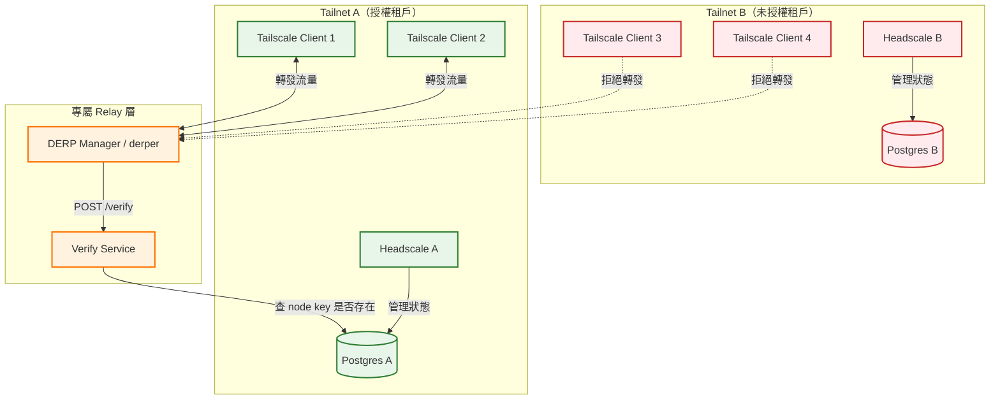

> 本文由 2025-11-27 的 HackMD PoC 報告（英文，*DERP Integration & High Availability (HA) POC Report*，Gemini CLI 產生的專案週報）於 2026-10-30 擴寫而成，屬 QuickLink VPN Cloud（Moxa 實習專案）連載。整體架構與 DERP 的 TLS 細節見姊妹篇[〈QuickLink VPN 架構〉](/blog/quicklink-vpn-architecture/)；本文專注在「誰有資格用我的 DERP」這個驗證問題。原理段落是擴寫時對照 derper 源碼（v1.88.3）補查的，與原稿衝突處已如實標註。

## 一、痛點：自架的 DERP 預設是公共設施

先問一個問題：你自架了一台 DERP relay，它憑什麼只服務你自己的 tailnet？

答案是——預設**沒有憑什麼**。derper 的 `--verify-clients` 預設是 `false`，也就是說任何一個 Tailscale 客戶端只要從 DERP map 上看到你的節點（或乾脆掃到 port），就能把它的流量塞進來轉發。它不能解密什麼——DERP 只轉發 WireGuard 加密後的封包，但你的頻寬和 CPU 就這麼被別人的 tailnet 吃掉了。這對「免費 tailnet 想蹭付費 DERP 資源」或企業多租戶場景（A 公司的 relay 不該服務 B 公司的節點）都是實際問題。

derper 原生有兩條驗證路線（以下契約均對照 v1.88.3 源碼 `cmd/derper/derper.go` 與 `derp/derp_server.go`）：

- **`--verify-clients`**：derper 主機自己跑一個 tailscaled、並加入某個 tailnet，驗證時透過 Unix socket 問它「這個 key 在不在你的 peer 清單裡」。問題是 derper 主機從此變成 tailnet 的一員，對「一台 relay 服務多個 tailnet」或「不想把 relay 註冊進任何 tailnet」的部署很不方便。
- **`--verify-client-url`**（v1.62 起新增，引入 commit [`10d130b845`](https://github.com/tailscale/tailscale/commit/10d130b845743c39a7c40421471fc47fb6b79153)，2024-02）：把驗證外包給一個 HTTP admission controller。這正是我們要的解耦點。

## 二、先把術語立好：machine key vs node key

這次 PoC 踩過的第一個坑就是 key 的種類，先定義清楚：

- **machine key**：主機層級的身分，一台機器一把，重新登入 tailnet 也不會變。
- **node key**：節點登入身分，logout 再 login 就會換新的一把。derper 握手時客戶端出示的是 **node key**。

這直接決定了資料庫該查哪個欄位——後面 §四 會回到這件事。

## 三、驗證契約：derper 怎麼問 admission controller

`--verify-client-url` 的契約定義在 `tailcfg/derpmap.go`：

```go
type DERPAdmitClientRequest struct {
	NodePublic key.NodePublic // key to query for admission
	Source     netip.Addr     // derp client's IP address
}

type DERPAdmitClientResponse struct {
	Allow bool // whether to permit client
}
```

也就是一個極簡的 HTTP 契約：

- **請求**：`POST <url>`，body 為 `{"NodePublic": "nodekey:64個hex", "Source": "10.0.0.7"}`
- **回應**：HTTP 200 + `{"Allow": true}` 或 `{"Allow": false}`

`derp_server.go` 的 `verifyClient()` 有三個值得知道的行為：

1. **逾時 5 秒**：`context.WithTimeout(ctx, 5*time.Second)`，驗證服務掛了不能拖死整台 derper。
2. **fail-open 預設開啟**：`--verify-client-url-fail-open` 預設 `true`——驗證服務**連不上時直接放行**。這對可用性友好，對「防白嫖」是災難：Verify Service 一掛，驗證形同虛設。要做私有 relay，**必須顯式設 `--verify-client-url-fail-open=false`**，寧可全拒不可全放。
3. **mesh peer 跳過驗證**：有設 mesh key 的 peer（DERP 叢集內部互聯）不會走驗證，因為它本來就不屬於任何 tailnet——這是合理的例外，部署多節點 derper 時要記得 mesh key 別外流。

## 四、Verify Service：一個查表的 admission controller

我們的實作是一個**無狀態 Go 服務**，接上指定租戶（Tailnet A）的 Headscale Postgres 資料庫。它只做三件事：收 node key → 查表 → 回 Allow。

這裡有一個**對原稿的修正**：原稿寫的查詢是 `WHERE machine_key = $1`，但對照 derper 源碼確認，驗證請求裡帶的是 **node key**（`DERPAdmitClientRequest.NodePublic`），而 Headscale 的 `nodes` 表同時有 `machine_key` 和 `node_key` 兩欄（見 headscale `hscontrol/db/schema.sql`），`GetNodeByNodeKey` 就是用 `node_key = ?` 配 `nodekey:hex` 格式在查。查 `machine_key` 永遠查不到東西。正確的查詢是：

```sql
SELECT EXISTS(SELECT 1 FROM nodes WHERE node_key = $1);
```

最小實作大致長這樣（示意）：

```go
var pool *pgxpool.Pool // 連到指定租戶的 Postgres，建議唯讀 replica

func verify(w http.ResponseWriter, r *http.Request) {
	var req struct {
		NodePublic string `json:"NodePublic"`
	}
	json.NewDecoder(r.Body).Decode(&req)

	var allow bool
	pool.QueryRow(r.Context(),
		`SELECT EXISTS(SELECT 1 FROM nodes WHERE node_key = $1)`,
		req.NodePublic).Scan(&allow)

	json.NewEncoder(w).Encode(struct {
		Allow bool `json:"Allow"`
	}{allow})
}
```

整體拓撲如下（Tailnet A 為授權租戶，Tailnet B 的節點會被拒）：



derper 端的設定就是把兩個 flag 指向 Verify Service：

```bash
derper \
  -hostname derp.example.com \
  -a :443 -certmode manual -certdir /etc/derp/certs \
  -verify-client-url http://verify:8080/verify \
  -verify-client-url-fail-open=false
```

## 五、PoC 驗證結果

測試環境沿用 QuickLink 的 Docker Compose 整合測試堆疊，客戶端用 `TS_DEBUG_ALWAYS_USE_DERP=true` 強制走 DERP（強制 relay 的方法見姊妹篇）：

| 步驟 | 動作 | 預期結果 | 狀態 |
|------|------|----------|------|
| 1 | 設定 | `derp-manager` 指向接 **DB A** 的 mock-verify-server | ✅ 已設定 |
| 2 | 註冊 Client A | `tailscale-1` 註冊到 **Headscale A** | key 進入 **DB A** |
| 3 | 強制 relay | `tailscale-1` 強制使用 DERP | ✅ ping 通過 DERP |
| 4 | 模擬 Client B | 用隨機/未知 key 走驗證（模擬 Tailnet B 的 `tailscale-3`） | ✅ 拒絕，Verify log 出 `Allow: false` |

結果：DERP server 實際上成為 Tailnet A 的私有資源，不在指定資料庫裡的客戶端一律拒收。

## 六、HA 與隔離：這個架構換到什麼

**高可用**：驗證解耦後，DERP 層不再依賴 Headscale 應用程式本身活著——它只需要資料庫可達（建議接唯讀 replica）。多台 derper 掛在 load balancer 後面、全部向同一個 Verify Service 驗證，水平擴展就是加容器的事。

**資源隔離**：把 Verify Service 指向哪個租戶的資料庫，哪個租戶的節點才吃得到這台 relay 的頻寬與 CPU。就算 DERP map 外洩，別的 tailnet（或公網上亂掃的人）的 key 也不存在於授權資料庫，進不來。要營運「共享 DERP、按租戶計費」的模式，就是讓 Verify Service 查多個租戶 DB 或一個集中授權視圖。

**順帶的好處**：因為查的是 node key，客戶端 logout 後重新登入會拿到新 key、寫進資料庫，驗證自然跟上；而原 PoC **沒有**檢查 `expiry` 或 `deleted_at`，只查「存在」——過期節點理論上仍會被放行，這是上線前要補的洞。另外每次驗證都是一次 DB round trip，原稿 next steps 裡的「Redis 快取 Allow 決策約 5 分鐘」是合理的下一步；開源社群也有同路線的實作（如 [`hellodword/tailscale-derp-client-verifier`](https://github.com/hellodword/tailscale-derp-client-verifier)，改查本地 allowlist 檔案），可作為參考。

誠實聲明證據等級：本文的契約細節（5 秒逾時、fail-open、mesh bypass、node key 格式）是擴寫時對照 tailscale v1.88.3 源碼查證的；PoC 本身是在 2025 年 11 月、QuickLink 的整合測試環境完成，當時測試用的 derper 版本與此不會差太遠——`--verify-client-url` 自 v1.62（2024-03）就存在。原稿由 Gemini CLI 產生，擴寫時修正了 `machine_key`/`node_key` 的混淆，其餘結論（含測試結果表）與原稿一致。

## 參考資料

- [cmd/derper/derper.go](https://github.com/tailscale/tailscale/blob/v1.88.3/cmd/derper/derper.go) — `--verify-client-url`、`--verify-client-url-fail-open` flag 定義
- [derp/derp_server.go · verifyClient()](https://github.com/tailscale/tailscale/blob/v1.88.3/derp/derp_server.go) — 5 秒逾時與 fail-open 行為
- [tailcfg/derpmap.go](https://github.com/tailscale/tailscale/blob/v1.88.3/tailcfg/derpmap.go) — `DERPAdmitClientRequest` / `DERPAdmitClientResponse` 契約
- [commit 10d130b845](https://github.com/tailscale/tailscale/commit/10d130b845743c39a7c40421471fc47fb6b79153) — admission controller 選項的引入 commit（v1.62，2024-02）
- [headscale/hscontrol/db/schema.sql](https://github.com/juanfont/headscale/blob/main/hscontrol/db/schema.sql) — `nodes` 表的 `node_key` / `machine_key` 欄位
- [headscale/hscontrol/db/node.go](https://github.com/juanfont/headscale/blob/main/hscontrol/db/node.go) — `GetNodeByNodeKey` 以 `nodekey:hex` 格式查詢
- [hellodword/tailscale-derp-client-verifier](https://github.com/hellodword/tailscale-derp-client-verifier) — 同契約的另一個開源實作
- 相關文章：[〈QuickLink VPN 架構〉](/blog/quicklink-vpn-architecture/)
