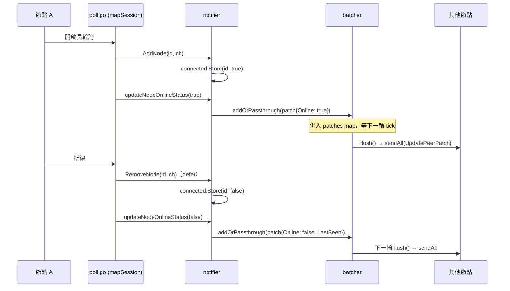

> 本文由 2025-07-24 的 HackMD 報告草稿擴寫而成，對照當時最新穩定版 **v0.26.1**（2025-06-06 發布）的原始碼逐項查證，原稿與源碼不符處已如實標註。Headscale v0.23 整套重構的搬遷地圖見姊妹篇[〈Headscale v0.23 升級與重構筆記〉](/blog/headscale-v023-upgrade/)。

自架 headscale 時，`headscale nodes list` 的 Online 欄位總是又即時又準，好奇它怎麼做到的。這篇走讀 `hscontrol/notifier`、`hscontrol/poll.go` 與 `hscontrol/mapper`，回答三個問題：節點上下線怎麼被記住、怎麼傳給其他節點、為什麼不寫進資料庫。

## 一、緣起：offline 節點不會變 offline

2023 年 9 月，vsychov 在 [issue #1561](https://github.com/juanfont/headscale/issues/1561) 回報：路由核准後 exit node 旗標要很久才出現，而且節點明明斷線了，狀態一直停在 online。kradalby 的修法落在 [PR #1564](https://github.com/juanfont/headscale/pull/1564)（2023-12 併入）：讓「online status 與 route change」有專門的傳播路徑。這條路徑後來經過兩輪整併，就是今天的 notifier。

## 二、兩張地圖與一條 channel

`notifier.Notifier`（v0.26.1 `hscontrol/notifier/notifier.go`）的核心是三個欄位：

```go
type Notifier struct {
    l         deadlock.Mutex
    nodes     map[types.NodeID]chan<- types.StateUpdate // 每節點一條 update channel
    connected *xsync.MapOf[types.NodeID, bool]          // 線上狀態，純記憶體
    b         *batcher
    // ...
}
```

節點開啟長輪詢時，`poll.go` 的 `mapSession.serveLongPoll()` 呼叫 `AddNode(node.ID, m.ch)`：登記這條專屬 channel、`connected.Store(id, true)`、metric 加一。若同一節點已經有舊 channel（手機換 Wi-Fi 快速重連的場景），會先丟 goroutine 呼叫 `safeCloseChannel` 關掉舊的再替換——這是 [#2536](https://github.com/juanfont/headscale/pull/2536)（2025-04 併入）修的 panic：多個 goroutine 對已關閉的 channel 再 `close` 會炸。

斷線時 `serveLongPoll` 的 defer 呼叫 `RemoveNode`。它有個精緻的防呆：**只刪「同一條」channel**——如果現在登記的 channel 指標跟傳進來的不一樣，代表節點已經被新連線取代，這次斷線是舊帳，不刪。然後 `connected.Store(id, false)`。

**原稿修正**：原稿說 RemoveNode 會關閉 channel，實際不會。`close` 只發生在 `Notifier.Close()`（關機）或 `AddNode` 替換舊 channel 時；斷線後 channel 的生命週期由 poll session 自己收。

## 三、為什麼叫 IsLikelyConnected

mapper 產生 `MapResponse` 時，對每個 peer 問一次 `m.notif.IsLikelyConnected(peer.ID)` 決定 `IsOnline` 欄位。這名字來自 2024-02 的 "Rework map session" commit（[`58c94d2b`](https://github.com/juanfont/headscale/commit/58c94d2bd33d0fd03336b8f2b56f63953c44abaa)），註解原文是：

> IsLikelyConnected reports if a node is connected to headscale and has a poll session open, but doesn't lock, so might be wrong.

對照組 `IsConnected` 會拿 `n.l` 鎖、結果準確；`IsLikelyConnected` 完全不碰鎖、直接無鎖讀 `connected` 這張 `xsync.MapOf`。mapper 是熱路徑——每次生成 peer 清單都逐點查——於是拿一點點過時的風險，換掉全域鎖競爭。"likely" 就是指這個小小的時間差。同一組改動還加了 `LikelyConnectedMap()` 把整張 map 借出去給 route failover 判斷用。

## 四、batcher：把風暴收斂成一輪

節點上下線本身也會觸發推播：`poll.go` 的 `updateNodeOnlineStatus` 組一個 `tailcfg.PeerChange{NodeID, Online, LastSeen}`（斷線時順手把 `last_seen` 寫進 DB），包成 `StatePeerChangedPatch` 丟給 notifier。真正的聚合者是 batcher——[PR #1905 "batch updates in notifier"](https://github.com/juanfont/headscale/pull/1905)（2024-04-27 併入）。kradalby 在 PR 描述的原話：

> This PR will move the batching and deduplication of node updates into the notifier, instead of the poller. This saves a huge amount of traffic going between and removes quite a lot of unnecessary updates when nodes are connecting and informing us several times.

機制分三支：`StatePeerChanged` 只把節點 ID 丟進 `changedNodeIDs` 集合（天然去重）；`StatePeerChangedPatch` 以 NodeID 為 key 併進 `patches` map，同節點多次 patch 用 `overwritePatch` 逐欄位覆蓋（`Online`、`Endpoints`、`KeyExpiry`……）；其他型別的 update 不等，直接 `sendAll`。背景 goroutine `doWork` 每 `BatchChangeDelay` tick 一次（`tuning.batch_change_delay`，預設 **800ms**）執行 `flush()`：先丟棄「已有完整更新」節點的殘留 patch，再把排序過的 changed nodes 打包成一次 `UpdatePeerChanged`、剩餘 patches 打包成一次 `UpdatePeerPatch`，各 `sendAll` 一輪後清空狀態。

**原稿修正**：原稿把上下線傳播寫成 `StatePeerChanged`，實際上節點上下線走的是 `StatePeerChangedPatch`（`Online` 欄位）；完整的 `StatePeerChanged` 是設定變更等事件用的。兩種 batcher 都吃，但語意不同。



## 五、IsOnline 不進資料庫

`types.Node` 的欄位定義很誠實：`IsOnline *bool` 掛著 `gorm:"-"`——GORM 根本不存它。資料庫只留 `last_seen`。`mapper.ListPeers` 產生回應時才即時問 `IsLikelyConnected` 填進去。理由很直觀：連線狀態每秒都在變，寫進 DB 只產生無意義的寫入放大；headscale 重啟後 `connected` 清空，但反正所有長輪詢也得重連，狀態自然重建。持久的事實（金鑰、IP、hostname、last_seen）歸 DB，短暫的現實歸記憶體。

## 六、版本脈絡

- **v0.23.0**（2024-09-18）：notifier channel 化與 batcher 隨 v0.23 開發期併入（batcher 即 #1905），整套 delta updates 架構成為正式行為。
- **v0.24.0**（2025-01-17）、**v0.25.0**（2025-02-11）：小改；v0.23 與 v0.26.1 的 notifier 幾乎逐行相同。
- **v0.26.0**（2025-05-14）：收錄 #2536 的快速重連 panic 修復；**v0.26.1**（2025-06-06）是本文撰寫時（2025-07-24）最新穩定版，程式碼引用皆以此 tag 為準。
- 後記（擴寫時補查）：v0.27 起 batcher 搬到 `hscontrol/mapper`（`mapper.Batcher`），2026 年 kradalby 又做了一輪正確性重寫（per-node `disconnectedAt`、per-node 工作序列化，[#3134](https://github.com/juanfont/headscale/pull/3134) 系列）——這套設計仍在演化中。
