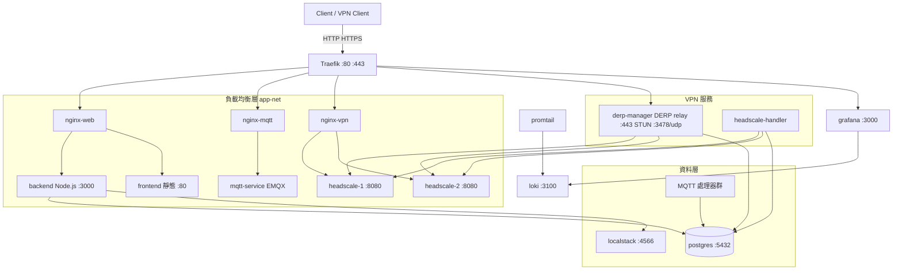
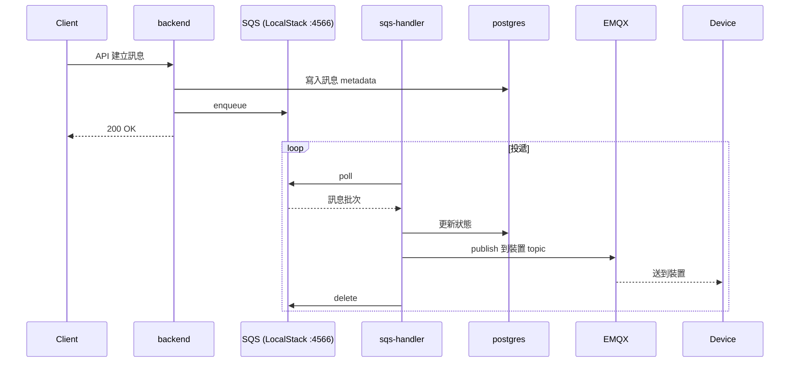

> 本文由 2025-11-20 的 HackMD 架構筆記於 2026-10-30 擴寫而成。原稿是一份純圖解筆記：把 `docker-compose.traefik.yml` 與 `docker-compose.derp-manager.yml` 兩份 compose 檔整理成 Mermaid 圖集，共 28 個服務。本文保留原始架構判斷，補上事後查證的版本脈絡與設計取捨；數據與架構皆來自該系統自身的 compose 檔與公開文件，不是 benchmark。

自架 VPN 這件事，教學都寫得很輕鬆——一個 headscale 容器、一條 docker run，就結束了。但只要你真的想把它變成一套「產品」：要有控制面板、要有裝置管理 API、要有訊息推播、要有日誌可以查，你就會發現控制面伺服器只是冰山一角。這篇是我把 QuickLink VPN Cloud 整個攤開來畫圖的記錄：**28 個容器、兩層 Docker 網路、三組 nginx 負載均衡**，全部塞在一組 Docker Compose 裡。

先把醜話說在前頭：這不是「教你五分鐘自架 VPN」的文章。這是給已經被自己的 compose 檔淹沒、想看看別人怎麼分層的人看的。圖會多，但每一張圖我都會講「為什麼要這樣」和「代價是什麼」。

## 全貌：兩層網路，28 個容器

整個系統只有兩條 Docker 網路：

- `traefik-public`：只有 edge 層站在上面——[Traefik](https://traefik.io/traefik/)、derp-manager、grafana。任何要對外服務的容器都必須明確加入這層。
- `app-net`：其餘所有服務的內部通訊層，資料庫和訊息佇列不會接觸到 edge。

服務的構成大致是：Go 服務 7 個（cronjob、sqs-handler、headscale-handler、兩個 MQTT handler，加上 headscale-1/2 本身）、Node.js 後端 1 個、靜態前端 1 個、基礎設施 11 個（traefik、三組 nginx、postgres、localstack、EMQX、loki、promtail、grafana、renderer）、工具型容器 3 個（cert-generator、ca-generator、config-generator）。這種「一個 function 一個容器」的切法在 compose 裡很自然，但代價是 `docker compose ps` 要捲動很久——後面會講我對這個重量的態度。

## Edge 層：traefik.me 魔法域名與憑證的坑

所有 HTTP/HTTPS 流量從 Traefik 進來，路由靠 host 規則。這套系統的 host 名稱全部掛在 `*.traefik.me` 底下，像是 `server.127.0.0.1.traefik.me`、`vpn.192.168.1.100.traefik.me`。

[traefik.me](https://traefik.me/) 是一個和 nip.io 同類的魔法域名：公共 DNS 伺服器直接把域名裡嵌的 IP 抽出來回傳，所以 `server.127.0.0.1.traefik.me` 解析回 127.0.0.1、`server.192.168.1.100.traefik.me` 解析回 192.168.1.100。好處是同一套 Host 規則，localhost 和 LAN 存取都通——這也是為什麼 Traefik 的路由規則用的是 `HostRegexp`（例如 `^vpn\.[a-zA-Z0-9.-]+\.traefik\.me$`）而不是精確 `Host()`，因為 IP 段會隨部署環境變動。

憑證則是靠 `cert-generator` 用 mkcert 自簽 + `ca-generator` 維護私有 CA。這裡有個歷史脈絡值得記一筆：traefik.me 早年還額外發放一份 Let's Encrypt 簽的共享萬用憑證（`https://traefik.me/cert.pem` 直接下載），但在 **2025 年 3 月被 Let's Encrypt 撤銷了**——把同一把私鑰發給所有訪客違反 CA/Browser Forum Baseline Requirements 的 sole control 規定（[經過詳述](https://guillaumedelre.github.io/2025/04/17/local-https-with-traefik-traefik.me-is-dead-long-live-sslip.io/)）。所以自簽 CA 不是懶惰，是唯一正解：要嘛自己 mkcert、要嘛上真的域名走 Let's Encrypt。

## VPN 控制面：headscale 雙實例的真相

架構圖上最引人注意的，大概是 `headscale-1` 和 `headscale-2` 兩個控制面實例並排、前面站著 `nginx-vpn` 負載均衡。看起來很像 HA，但我必須誠實地說：**這不是 upstream 支援的部署方式。**

[Headscale 的 FAQ](https://headscale.net/stable/about/faq/) 明載推薦單一程序配 SQLite，PostgreSQL 雖然仍支援但「considered to be in maintenance mode」；源碼裡甚至留過一句「using Postgres is highly discouraged, it is only supported for legacy reasons」。至於多實例 HA，2025 年 7 月有人開了 [issue #2695](https://github.com/juanfont/headscale/issues/2695) 詢問，維護者 kradalby 的回答是「**The short answer is no**」——理由是控制面是低流量協調服務，值得的是「快速從備份重建」而不是多寫者同步。

所以這套系統的雙實例，實際運作比較像「兩個實例共用同一個 Postgres、用 LB 分流註冊請求」，而不是 upstream 語義上的 failover 叢集。它能跑，內部系統用沒問題；但如果讀者要抄這個架構，請先知道自己站在 upstream 的保證範圍之外。這也是我在自己的 [Headscale v0.23 升級筆記](/blog/headscale-v023-upgrade/)裡維護多實例 fork 時反覆確認過的事：fork 裡的每一行，都是自己簽的保固。

## DERP relay：UDP 打不通時的最後防線

`derp-manager` 是這套系統裡我最喜歡的一個自製服務。它身兼三職：

| 埠 | 用途 |
| --- | --- |
| `:443` (HTTPS) | [DERP](https://tailscale.com/blog/how-tailscale-works/) relay——Tailscale 語義的「Designated Encrypted Relay for Packets」，純 HTTP 之上的加密封包轉送，NAT 打洞失敗時的 fallback |
| `:3478/udp` | [STUN](https://tailscale.com/docs/reference/stun-protocol)——讓客戶端知道自己被 NAT 看成什麼 `ip:port`，判斷 easy NAT 還 hard NAT |
| `:8080` | DERP map API——客戶端啟動時從 `manager.*.traefik.me` 拉relay 清單 |

Tailscale 的 [NAT traversal 長文](https://tailscale.com/blog/how-nat-traversal-works/)把這套機制講得很清楚：連線永遠先走 DERP 立刻可用，同時並行跑 STUN/ICE 探測，探出直連路徑就升級。自己架一個 DERP 的意義就在這——官方 relay 清單裡沒有你的內網，內部系統要有一台自己控制延遲的 relay。

它的 hostname 模式是 `derp-manager.<IP>.traefik.me`，跟 edge 層同一套魔法域名邏輯；另有 `DERP_HOSTNAME` 環境變數可以整個覆蓋掉，部署到雲上掛真域名用。啟動腳本按 `ENV_TYPE` 分流：`env_docker`/`env_local` 走 mkcert 自簽，`env_cloud_*` 走 AWS metadata + Let's Encrypt + Tailscale 授權——同一個映像，本地和雲上只差環境變數。

## 訊息流：SQS → Postgres → EMQX

裝置管理類系統的共同需求是「下發訊息給 N 台裝置」。這套的切法是把 API 和投遞完全解耦：

MQTT broker 用 [EMQX](https://docs.emqx.com/en/emqx/latest/deploy/install.html)，埠就是它的預設組合：`1883`（TCP）、`8883`（TLS）、`8083`（WebSocket，瀏覽器端裝置模擬用，走 `mqttws.*.traefik.me`）、`18083`（Dashboard）。前面站 `nginx-mqtt` 轉發。旁邊還有 `mqtt-service-handler`（狀態回寫 Postgres）和 `mqtt-publish-handler` 兩個小 Go 容器。

本地開發用 [LocalStack](https://docs.localstack.cloud/aws/customization/networking/accessing-endpoint-url/) 假裝自己是 SQS/S3——4566 單一 edge 埠收所有 AWS API。`ENV_TYPE` 一切換，同一份程式碼在雲上就打真的 SQS。這招的好處是本地開發零成本、離線可跑；壞處是 LocalStack 和真 AWS 的行為差異（SQS 的 visibility timeout 邊界、S3 的 host-style bucket URL）遲早會咬你一口，所以關鍵路徑還是建議上真環境驗證過。

## 可觀測性：Promtail → Loki → Grafana

日誌這層沒有花活：所有服務容器打上 `logging=promtail` 標籤，`promtail` 掛 `/var/run/docker.sock` 自動發現有標籤的容器、抓 Docker log driver 的輸出推進 `loki:3100`，`grafana:3000` 預先配好 Loki datasource，另掛一個 `renderer`（headless Chrome）把面板渲染成圖片方便推播。

這套組合的運維重量極低——不用改任何應用程式碼，加新服務只要貼標籤。代價是那個掛進去的 Docker socket：promtail 理論上只需要讀日誌，但 socket 給它的權限是整個 Docker API（含啟停容器）。信任邊界要自己想清楚，至少要限 `:ro`。

## 啟動順序與健康檢查

28 個容器的啟動順序不是開玩笑的。compose 層面靠三種條件保住正確順序：`postgres` 和 `localstack` 用 healthcheck + `condition: service_healthy`；`config-generator`、`cert-generator`、`db-init` 這類一次性容器用 `service_completed_successfully`；其餘用 `service_started`。`ca-generator` 生出的 CA 還要寫進 Postgres 再簽發裝置憑證。這套東西一旦少了 healthcheck，`nginx-vpn` 會在 headscale 起來之前開始轉發 502——第一次踩到時會花你一個晚上。

## 誠實評價：這套架構的代價

優點先說：職責切得乾淨（edge/LB/app/data 四層）、`ENV_TYPE` 讓同一份 compose 從筆電長到雲上、日誌零侵入、訊息投遞和 API 完全解耦。這些都不是紙上談兵，是 compose 檔裡實際寫得出的東西。

但代價也得攤開：

- **PostgreSQL 12 已經 [EOL](https://www.postgresql.org/support/versioning/)（2024 年 11 月）**——原稿寫作時它就是過期版本了，新部署沒理由再用，升級要連資料遷移一起排。
- **headscale 雙實例不在 upstream 保證範圍內**（見上文 issue #2695），這是整個架構最需要自覺的一點。
- **28 個容器的重量**：每次 `docker compose up` 全家桶都要醒一遍，工具型容器（cert/ca/config-generator）雖然跑完就退出，但拉鏡像、啟動順序的複雜度是實打實的。內部系統可以接受，公開服務我會先砍一半。
- **traefik.me 依賴公共 DNS 服務**：域名是別人的，憑證得自己簽，斷網或 DNS 服務變動時 LAN 存取會直接失效。認真用就掛自己的域名。
- **LocalStack 的模擬保真度**：SQS/S3 的快樂路徑沒問題，但錯誤路徑和配額行為和真 AWS 有差，測試金字塔別只靠它。

總的來說，這是一份「把自架 VPN 當產品做」的架構範本：它的價值不在單一元件，而在**分層的紀律**——誰能碰 edge、誰只在內網、一次性容器怎麼注入憑證與設定、雲地差異怎麼收進環境變數。這些紀律搬到任何一套自架服務上都不吃虧。

## 對外服務一覽（本地開發環境）

| 服務 | URL |
| --- | --- |
| 前端 | `http://frontend.127.0.0.1.traefik.me` |
| 後端 API | `http://server.127.0.0.1.traefik.me` |
| MQTT WebSocket | `http://mqttws.127.0.0.1.traefik.me` |
| EMQX Dashboard | `http://mqtt.127.0.0.1.traefik.me` |
| VPN 控制面 | `http://vpn.127.0.0.1.traefik.me` |
| DERP map API | `http://manager.127.0.0.1.traefik.me` |
| DERP relay | `https://derp-manager.127.0.0.1.traefik.me` |
| Grafana | `http://grafana.127.0.0.1.traefik.me` |

以上 IP 段換成 LAN IP 即可從同網段裝置存取。

## 延伸閱讀

- [Headscale v0.23 升級與重構筆記](/blog/headscale-v023-upgrade/)——同一套多實例思維在 upstream 重構後的移植記錄
- [Tailscale: How NAT traversal works](https://tailscale.com/blog/how-nat-traversal-works/)——DERP/STUN/ICE 的原理，本文 VPN 部分的理論基礎
- [headscale issue #2695](https://github.com/juanfont/headscale/issues/2695)——維護者親自回答「為什麼不做 HA」
- [traefik.me](https://traefik.me/)——魔法域名本尊；[憑證被撤銷的始末](https://guillaumedelre.github.io/2025/04/17/local-https-with-traefik-traefik.me-is-dead-long-live-sslip.io/)
- [PostgreSQL 版本政策](https://www.postgresql.org/support/versioning/)——五年 EOL 時鐘，PG12 已於 2024 年 11 月終止支援
