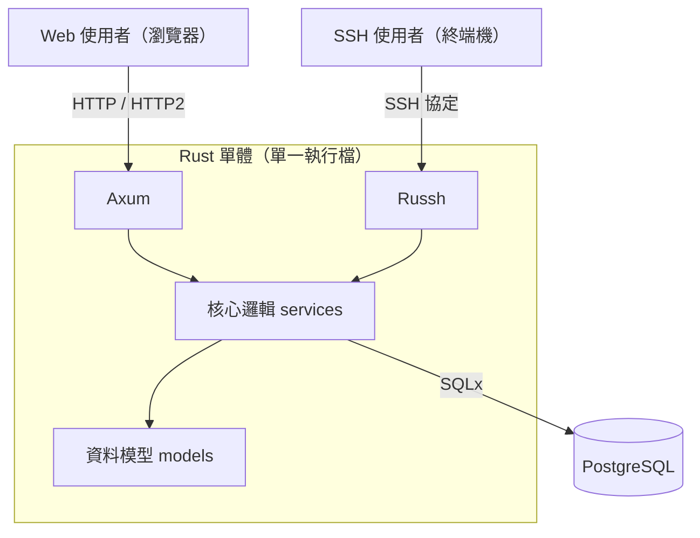

> 本文整理自 2026 年 4 月 28 日的一份 HackMD 架構設計筆記（專案代號 `rusty-bbs`）。**它是一份設計與實作計畫，不是完工心得**——專案尚未落地，文中的版本號以發文當下（2026 年 4 月底）的 crates.io 為準。寫下這篇的目的是把「為什麼這樣選」講清楚，供未來的自己（或你）動工前參考。

## 痛點：一個 BBS，兩個世界

想做一個現代版的 BBS，馬上會遇到一個老問題：老鄉民從終端機 `ssh` 進來用 TUI 介面，新手用瀏覽器開網頁。常見做法是寫兩套系統、各掛一個資料庫，結果是資料結構重複定義、業務邏輯改兩次、兩邊行為永遠對不齊。

這份設計的答案是：**單一 Rust 執行檔，兩個入口**。同一個 binary 裡同時跑 HTTP server 和 SSH server，共用同一組 models 和 services，底層同一個 PostgreSQL。Web 跟 SSH 不是兩個產品，只是同一個核心的兩種呈現層。



## 技術堆疊與選型理由

先立術語再展開：這裡的「雙頭」（dual head）指同一行程式在兩個 port 上各聽一種協定；「呈現層」指 Axum handler 或 Ratatui widget 這種只負責畫面的程式碼，「核心層」指 services 裡與介面無關的業務邏輯。架構能否成立的關鍵，就是核心層完全不 import 任何呈現層的型別。

各元件的選擇（版本為 2026 年 4 月底 crates.io 上的最新 stable，授權皆為寬鬆授權，可商用）：

- **語言**：Rust，edition 2024（1.85 起穩定，已是預設 edition）。
- **Web 層：[Axum](https://github.com/tokio-rs/axum) 0.8.8（MIT）**。Tokio 官方維護、extractor 式的人體工學好寫，與後面的 tokio 生態零縫隙。
- **SSH 層：[Russh](https://github.com/warp-tech/russh) 0.60.1（Apache-2.0）**。目前 Rust 生態最成熟的純 Rust SSH 實作，不需要外包給 OpenSSH 子程序。
- **TUI：[Ratatui](https://github.com/ratatui/ratatui) 0.30.0（MIT）**，backend 用 [crossterm](https://github.com/crossterm-rs/crossterm) 0.29.0。Ratatui 已是 Rust TUI 的事實標準。
- **資料庫存取：[SQLx](https://github.com/launchbadge/sqlx) 0.8.6（MIT OR Apache-2.0）**，配 PostgreSQL 16。選 SQLx 而非 ORM 的理由是編譯期 SQL 檢查——`sqlx::query!` 巨集直接對著真資料庫驗證 SQL，schema 改了沒跟上就編譯失敗，對系統工程師思維的人特別對味。
- **網頁前端：[Askama](https://github.com/askama-rs/askama) 0.15.6（MIT OR Apache-2.0）** 型別安全模板 + [HTMX](https://htmx.org/) 局部互動 + Tailwind 樣式。不上 SPA 框架，讓 Web 端維持「server-side render + 少量 snippet」的簡單性，也和 TUI 端的厚重邏輯形成對稱——兩邊都沒有獨立的前端 build chain。
- **非同步執行期**：tokio 1.52。這是整個「單體雙頭」得以成立的前提。

整套堆疊最核心的一個理由只有一句話：**Web 和 SSH 共用同一組 Rust structs**。`models::Post` 定義一次，Axum 把它序列化進 Askama 模板、SSH 端把它畫成 Ratatui 列表，兩邊看到的永遠是同一份資料的同一種形狀。

## 目錄結構：扁平、模組化、呈現層分家

```text
rusty-bbs/
├── Cargo.toml / Dockerfile / docker-compose.yml
├── migrations/           # SQLx migrations
├── src/
│   ├── main.rs           # 入口：同時啟動 Web 與 SSH server
│   ├── config.rs         # 環境變數設定
│   ├── db.rs             # 連線池初始化
│   ├── models/           # User / Board / Post 結構
│   ├── services/         # 業務邏輯（發文、認證）—— 兩端共用
│   ├── web/              # Axum handlers + Askama 模板
│   └── ssh/              # Russh server + Ratatui 畫面
└── templates/ / assets/
```

原則很簡單：`services/` 不依賴 `web/` 或 `ssh/`，依賴方向永遠由呈現層指向核心層。這樣就算未來想加第三個入口（例如 gRPC 或 WebSocket），核心層一行都不用動。

## 雙頭啟動：`tokio::spawn` 兩個 server

整個架構最關鍵的一步，其實程式碼短得出乎意料——在 `main.rs` 裡把兩個 server 各自 spawn 成 tokio task：

```rust
#[tokio::main]
async fn main() -> anyhow::Result<()> {
    let pool = db::init_pool().await?;

    let web_pool = pool.clone();
    let web_handle = tokio::spawn(async move {
        web::start_server(web_pool).await
    });

    let ssh_pool = pool.clone();
    let ssh_handle = tokio::spawn(async move {
        ssh::start_server(ssh_pool).await
    });

    let _ = tokio::join!(web_handle, ssh_handle);
    Ok(())
}
```

能這樣寫，是因為 Axum 和 Russh 都建構在 tokio 之上：同一個 runtime、同一個連線池（`Arc` clone 即可），沒有跨 runtime 通訊的問題。單體在這裡不是偷懶，而是刻意的架構決策——部署物只有一個 binary + 一個 Postgres，docker-compose 兩個服務搞定。

## 最難的部分：SSH over network 的 TUI

Phase 計畫裡被標記為 "The Hard Part" 的是 SSH/TUI 整合，有兩個坑值得先講：

1. **PTY 請求**：在 Russh 端實作 `russh::server::Handler` trait，`channel_open_session` 被呼叫後要正確處理 PTY（pseudo-terminal）請求——沒有 PTY，終端機就不會進入 raw mode，TUI 根本畫不上去。
2. **輸出導向**：crossterm 預設寫本地 stdout，但這裡的「螢幕」是遠端使用者的 SSH channel。所以需要一個轉接層，把 `ratatui::Terminal` 的輸出 stream 導向 Russh 的 channel，而不是 stdio。這是整份計畫裡最可能要自己造輪子的地方，官方沒有現成組合。

之後就是標準的 Ratatui 事件迴圈：收 SSH key event → 更新 app state → `terminal.draw()` 重繪。

Web 端（Phase 5）則相對例行：`GET /` 看板列表、`GET /board/:slug` 文章列表、`POST /post` 收 form 寫入 DB 後回傳 HTMX snippet 更新列表，全程不需自寫 JavaScript。

## 實作切片：五個 Phase、四週路徑

計畫按風險遞減排序，先驗證最容易卡死的部分：

| 週次 | 目標 | 驗收 |
|---|---|---|
| Week 1 | Skeleton & DB | docker-compose 跑起來，`SELECT 1` 編譯通過，Axum Hello World |
| Week 2 | SSH prototype | `ssh localhost -p 2222` 看到 "Welcome to Rusty BBS" 純文字 |
| Week 3 | TUI integration | SSH 連線內用假資料畫出 Ratatui 列表 |
| Week 4 | Logic connection | 真資料餵給兩端，實作「發文」 |

其中 Week 2 的難點預警是理解 Russh 的 Handler callback 機制——它的設計是「你實作 trait、框架回呼你」，跟直覺的「你寫主迴圈」相反，第一次寫容易卡住。資料庫 schema 本身很樸素：`users`（含 `ssh_key` 欄位做 SSH 公鑰自動登入）、`boards`、`posts` 三張表，靠外鍵串起來。

## 誠實聲明

這是一份紙上設計：上述架構、程式碼都是概念驗證等級的草稿，尚未經過實際編譯與部署的檢驗。特別是「crossterm 輸出導向 Russh channel」這段，文獻上可行（兩者都是 async writer），但實作細節（例如 channel flow control、視窗大小變更事件 `SIGWINCH` 的對應處理）要等真的動工才知道深淺。如果你正好也想做 BBS 或任何雙入口服務，這份選型清單和 Phase 切片順序應該能幫你省掉一些摸索——但請把它當草圖，不是藍圖定案。

### References

- [Axum](https://github.com/tokio-rs/axum)（tokio-rs/axum，MIT）
- [Russh](https://github.com/warp-tech/russh)（warp-tech/russh，Apache-2.0）
- [Ratatui](https://github.com/ratatui/ratatui)（ratatui/ratatui，MIT）／[crossterm](https://github.com/crossterm-rs/crossterm)（MIT）
- [SQLx](https://github.com/launchbadge/sqlx)（launchbadge/sqlx，MIT OR Apache-2.0）
- [Askama](https://github.com/askama-rs/askama)（askama-rs/askama，MIT OR Apache-2.0）
- [HTMX](https://htmx.org/)、[Rust Edition 2024（Rust 1.85 release notes）](https://doc.rust-lang.org/edition-guide/rust-2024/index.html)
