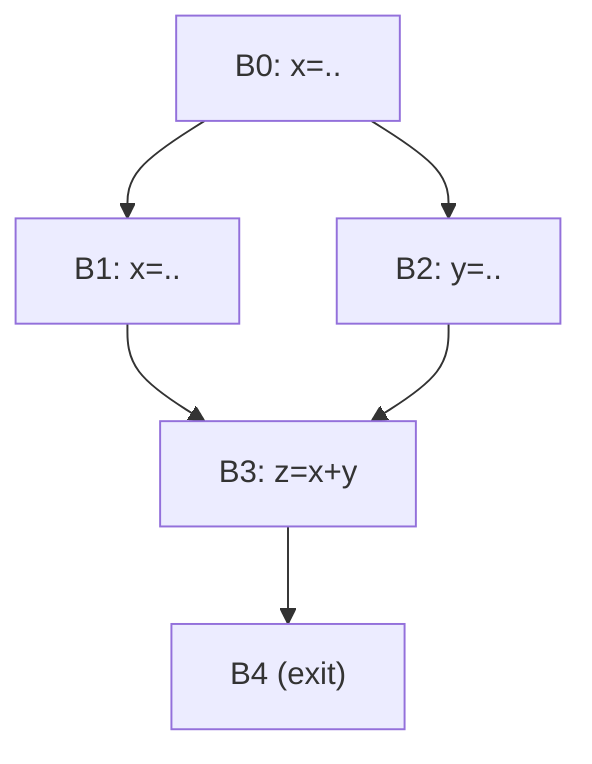
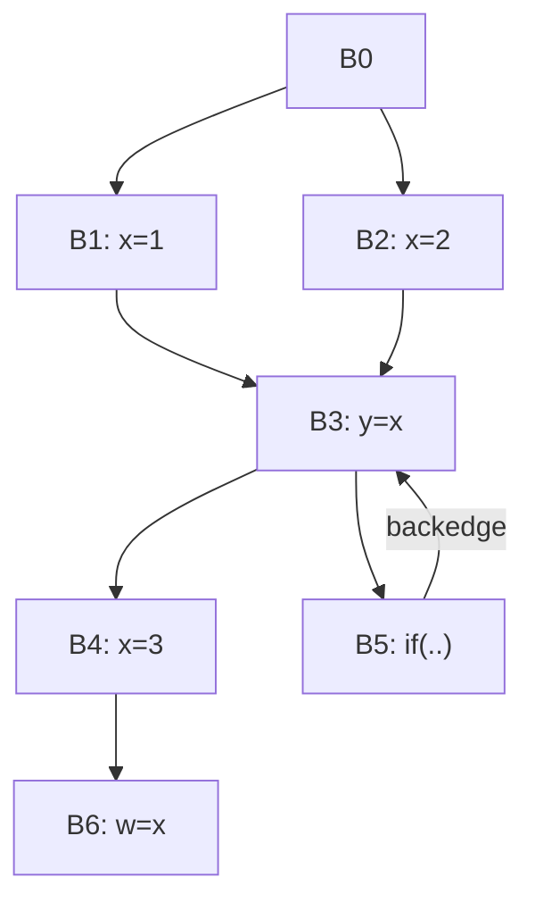
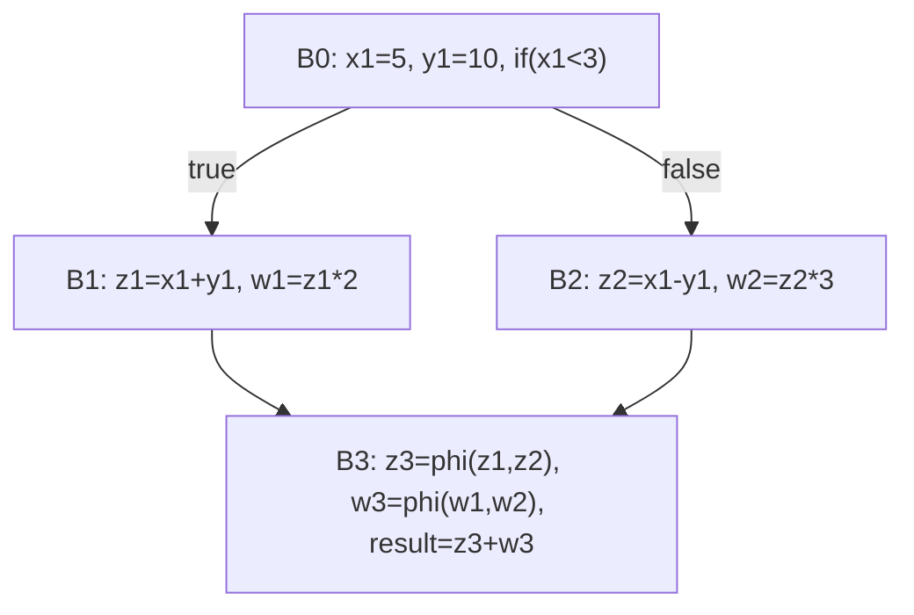
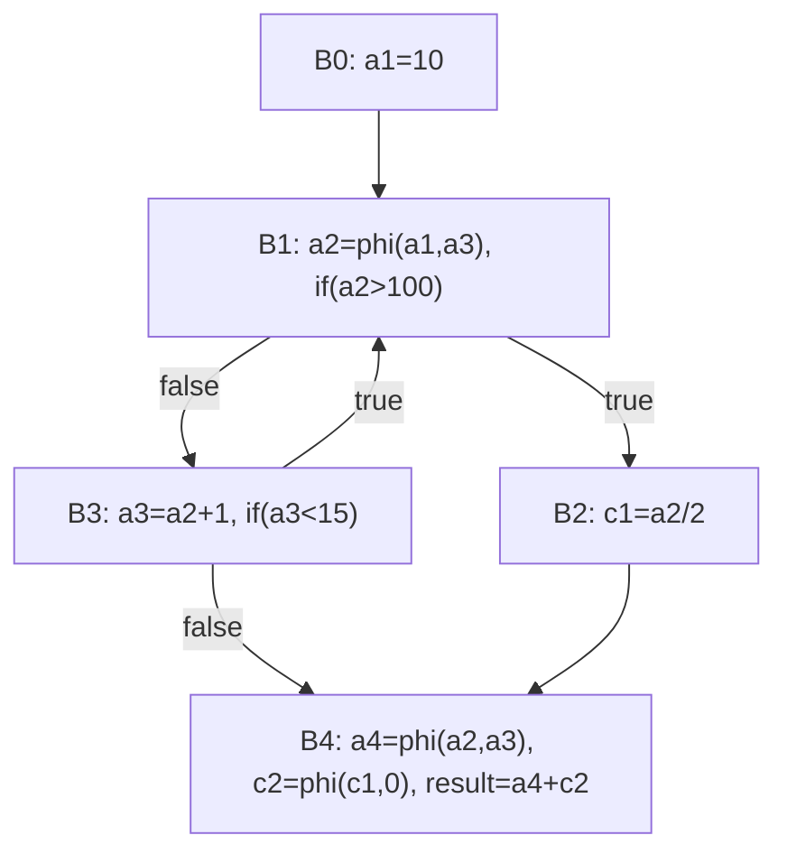

本文擴寫自 2025-11-14 的課程筆記，原稿是高等編譯器設計課程期中考的 SSA／最佳化題解，涵蓋支配分析、SSA 建構、迴圈最佳化與 SSA 上的稀疏分析四條主軸。以下逐題保留題目與詳解，並補上原始文獻與編譯器實作的對照；行文先立術語再展開。文中的 CFG 以 mermaid 圖示，程式片段以 C 或 pseudo-SSA 記法書寫。

## 術語定義

- **SSA（Static Single Assignment）**：每個變數只被賦值一次的中間表示，後續使用直接引用該定義；定義到使用是顯式邊，def-use chain 退化為一條指標。SSA 的精神是「把資料流資訊直接編進程式表示裡」，許多分析因此從全域資料流方程退化成沿邊走訪 [1][2]。
- **φ-node（φ-function）**：在多條控制流邊匯合的 basic block 開頭，把各前驅帶來的同名版本合成一個新版本，如 `x₃ = φ(x₁, x₂)`。LLVM IR 中即是 `phi` 指令 [3]；Appel 指出 φ 的左邊對應函式式寫法的形參、右邊各項對應實參——SSA 其實是一種函式程式設計 [2]。
- **Dominator**：從 entry 到 Y 的所有路徑都經過 X，則 X 支配（dominate）Y；X ≠ Y 時稱嚴格支配（strictly dominate）。節點支配自己 [1]。
- **Dominance Frontier（DF）**：`DF(X) = { Y | X 支配 Y 的某個前驅，但 X 不嚴格支配 Y }`，即 X 的「勢力邊界」[1]。
- **Iterated Dominance Frontier（DF⁺）**：對定義點集合反覆取 DF 直到不動點；minimal SSA 的 φ 放置就是「在每個定義點所屬變數的 DF⁺ 上插 φ」[1]。
- **Post-dominator 與 control dependence**：在反向圖上做支配分析得 post-dominator；若存在路徑 X→Y 且 Y post-dominate 路上所有節點但不 post-dominate X，則 Y control-dependent on X[1]。
- **歸納變數（induction variable）**：每圈以固定步進變化的變數；`i` 是 basic IV，`i*4` 這類 `i` 的線性函式是 dependent IV，可各配一個輔助變數做強度削減（strength reduction），把乘法換成加法。
- **常數折疊／傳播**：編譯期直接算出常數運算式、把值沿 SSA 圖傳播；配合分支消去與 DCE 可整段化簡。條件分支下的常數傳播（sparse conditional constant propagation）由 Wegman 與 Zadeck 提出 [8]。

---

## Q1：Dominance Frontier 計算

CFG 如下（diamond 形，B0 為 entry）：



求 `DF(B1)`。先算 dominators：`dom(B3)={B0,B3}`（B1、B2 都能到 B3，兩者皆非支配者）；`dom(B4)={B0,B3,B4}`。檢查 B3：B1 支配其前驅 B1（節點支配自己），但 B1 不嚴格支配 B3（存在 B0→B2→B3），故 `B3 ∈ DF(B1)`。檢查 B4：其唯一前驅 B3 不被 B1 支配，故 B4 不在 DF 內。**答案：`DF(B1) = {B3}`（D）。** 常見陷阱是把 DF 誤解成「支配樹上 X 的子孫邊界」直接把 B4 也算進來——B4 能進 DF 的前提是 X 支配 B4 的**某個前驅**，而 B4 唯一前驅 B3 根本不被 B1 支配。另外節點支配自己是定義的一部分，別漏掉。DF 的正式定義與線性時間演算法見 Cytron et al. [1]。

## Q2：Iterated Dominance Frontier 與 φ 放置



`x` 的定義點為 `{B1, B2, B4}`。`DF(B1)={B3}`、`DF(B2)={B3}`、`DF(B4)=∅`（B4 嚴格支配唯一後繼 B6）。故 `DF⁺ = {B3}`，只需在 **B3 放一個 φ**：`x₃ = φ(x₁, x₂, x₃)`（三個前驅 B1/B2/B5，第三個參數來自回邊）。注意這是帶回邊的迴圈：第一圈進 B3 時 `x₃` 尚未由回邊定義，但 φ 的參數對應的是「控制流到達時」的版本，語意上仍正確。B6 只有一個前驅、且其定義 B4 嚴格支配它，不需 φ；同一變數在同一 block 也絕不會放兩個 φ（選項 D/F 的「iteration effect」是虛構的）——iteration 只影響 φ 落在哪些 block，不會讓同一 block 重複放置。**答案：C，B3 一個 φ。** 這正是「minimal SSA = 定義點的 DF⁺ 上放 φ」的標準結果 [1]；Appel 亦指出 φ 的每個參數對應函式式寫法的一個實參 [2]。

## Q3：Post-dominator 與 Control Dependence

CFG：B0→B1（`if(p)`）→{B2, B3}，B2→B4→exit，B3→exit。求 B2 control-dependent on 誰。

反向圖的 post-dominators：`postdom(B2)={B2,B4}`。路徑 B1→B2 上 B2 post-dominate 自身，但 B2 不 post-dominate B1（存在 B1→B3 繞過 B2）——兩條件皆成立，故 **B2 control-dependent on B1（B）**。直覺上：`if(p)` 的結果決定 B2 執不執行——p 為真時 B2 執行、為假時整段跳過，這就是 control dependence 的定義本質。其餘選項都不成立：B0 沒做任何控制決策；B4 只是 B2 的下游，不是 B2 的「控制者」；B3 是另一條替代路徑，同樣管不到 B2；標準定義下節點也不對自己 control-dependent。此定義與 control dependence graph 的建構同樣出自 Cytron et al. [1]——同一篇論文同時給了 SSA 與 CDG 的線性建構法。

## Q4：LICM 與例外安全性

```c
B0 -> B1;  B1: if(i<n) -> B2, exit;
B2: t=a/b; c[i]=t; i++; -> B1   // a,b 迴圈不變
```

把 `t = a/b` hoist 到 B1 之前，何時違法？核心原則：**最佳化若在原本不會丟例外的路徑上引入「新的」例外，即屬違法**。關鍵情境是零圈次迴圈（`n ≤ 0`）：原程式一次都不執行除法，hoist 後除法必執行——若 `b = 0` 就在原來乾淨的路徑上憑空丟出 exception，違法。反過來，若迴圈必跑且 `b=0`，兩版本都丟例外，沒有「新」例外，合法。除法 set CPU flags、浮點 NaN 傳播都不算可觀察的新例外。**答案：E（僅 B：零圈次時不得引入新例外）。** 換個角度總結：hoisting 的合法性取決於「原程式裡這條運算是否必執行」。迴圈至少跑一次時，除法在兩版本都執行，例外行為一致；零圈次時 hoisting 把「可能不執行」變成「一定執行」，才會踩到新例外。因此實務上編譯器做 LICM 前要先證明運算在原程式中必執行（must-execute），或接受「hoisted 後可能多算一個沒人用的值但不能多丟例外」的約束。LLVM 的 LICM 只 hoist「must-execute（guaranteed-to-execute）」的運算，理由相同 [4]；例外語意見 LLVM LangRef 對指令副作用與可觀察行為的規範 [3]。

## Q5：φ 放置（簡單 diamond）

CFG：B0（`x=1`）→ B1（`if(p)`）→ {B2（`x=2`）, B3}→ B4（`z=x`）。`x` 定義於 `{B0, B2}`；`DF(B2)={B4}`（B2 支配前驅 B2 但不嚴格支配 B4），`DF(B0)=∅`。故 DF⁺={B4}，**只在 B4 放 φ：`x₄ = φ(B2: x₂, B3: x₀)`（G）**。B3 路徑把 B0 的 `x₀` 原封不動帶過來——這是 φ 參數可以「指回更上游定義」的例子：φ 的參數不必來自直接前驅的定義，只要該定義能到達即可。φ 放在匯合點而非定義點；B1 雖是 if 的分支點，但對 `x` 而言不是定義匯合處，不需 φ。這是「minimal SSA = 定義點的 DF⁺ 上放 φ」最乾淨的小例子 [1]。

## Q6：迴圈強度削減（Strength Reduction）

原迴圈 `a[i*4] = i*4+10; b[i*4] = i*8;`。對 `i` 的每個線性函式造一個輔助歸納變數，初值取 `i=0` 時的值，每次迴圈加上 stride：

```c
t1 = 0;  t2 = 0;  t3 = 10;   // t1: i*4、t2: i*8、t3: i*4+10
for (i = 0; i < n; i++) {
    a[t1] = t3;
    b[t1] = t2;
    t1 += 4;  t2 += 8;  t3 += 4;
}
```

驗證 `i=1` 時 `t1=4, t2=8, t3=14`，與原式 `a[4]=14, b[4]=8` 一致；`i=2` 時 `a[8]=18, b[8]=16` 亦同。每輪把 3 個乘法換成 3 個加法，多數架構上乘法延遲是加法的數倍，收益穩定。**答案：H。** 易錯點有三：`t2` 追蹤 `i*8`，步進必須是 8 而非 4；`+10` 是常數不隨 `i` 變，所以 `t3` 步進同 `t1`（+4）；兩個陣列都用 `i*4` 定址，共用同一個 `t1` 即可，不必為 `a`、`b` 各造一個。歸納變數的辨識（basic IV 與 dependent IV）與強度削減的系統性處理可對照 LLVM 的 `indvars` pass [4]。

## Q7：強度削減何時「不划算」

架構條件：乘法 3 cycles、加法 1 cycle；16 個 GP 暫存器，目前已用 14。強度削減引入新活躍變數 `p`（指向 `array[i*stride]`），暫存器壓力升到 15；若再擠破 16 上限就發生 **register spilling**——每輪 5+ cycles 的 store/load，100 圈下 1000+ cycles 的代價遠高於省下的 ~250 cycles，淨損約 750 cycles。**答案：D（額外活躍變數導致 spilling 時不划算）。** 逐項排除干擾選項：`stride=1` 時指標步進依舊比乘法便宜，某些架構還有 auto-increment 定址模式可用；`stride=1024` 這類大常數不影響「加法換乘法」的算術成本；迴圈主體很大反而攤薄變換成本；stride 不是編譯期常數也無妨——`p += stride` 在執行期照樣運作；乘法只要 1 cycle 也只是收益縮小，不會主動倒賠。強度削減本質是**用儲存（暫存器）換計算**，收益成立的前提是暫存器夠用。

## Q8：LICM 與強度削減各適用誰

```c
for (i = 0; i < n; i++) a[i] = b[i] * factor + offset;
```

- `i`（以及透過它計算的 `&a[i]`、`&b[i]`）：**強度削減**——改成 `pa++`、`pb++` 指標步進。
- `factor`、`offset`：迴圈不變，**LICM**（載入可移出或至少只做一次）。
- `b[i]`：隨 `i` 變，不可 hoist；其定址可隨 `i` 一起被強度削減。
- `b[i] * factor`：既非 `i` 的線性函式（不可強度削減）、每圈值都變（不可 LICM）。**誰都救不了它。**

**答案：A（強度削減：`i`；LICM：`factor`、`offset`，但不含 `b[i]*factor`）。** 判斷口訣：強度削減看「是不是歸納變數的線性函式」，LICM 看「每圈是否同值」。

## Q9：Horner 法的多項式求值

求 `2x³ + 3x² + 4x + 5`。

- 展開式（naive，不計 CSE）：`2*x*x*x`（3 mul）＋ `3*x*x`（2 mul）＋ `4*x`（1 mul）＝ **6 mul**。
- Horner：`((2*x + 3)*x + 4)*x + 5` ＝ **3 mul**。

**答案：A（6 vs 3）。** n 次多項式 Horner 法只要 n 次乘法（O(n)），naive 展開為 n(n+1)/2 次（O(n²)）；差距隨次數線性放大。Horner 法同時有較好的數值穩定性（減少捨入誤差累積）與規律的相依鏈（`result = result*x + aᵢ` 逐項滾動），利於管線化 [7]。即使加上 CSE 把 `x²`、`x³` 共用：

```c
t = x*x;               // 1 mul
t2 = t * x;            // 1 mul（x³）
result = 2*t2 + 3*t + 4*x + 5;  // 2 mul，共 4 mul
```

降到 4 mul，仍不如 Horner 的 3。注意 3 vs 6 是演算法層面的差異，與最佳化等級無關——除非編譯器自己把展開式改寫成 Horner 形式，那已經是演算法替換而非單純的常數折疊。

## Q10：SSA 常數折疊＋DCE 全流程



`x₁=5, y₁=10` → `if(5<3)` 恆假 → B1 不可達、刪除。B2：`z₂=5-10=-5`、`w₂=-5*3=-15`。B3 的 φ 只剩一個可達前驅：`z₃=φ(⊥,-5)=-5`、`w₃=φ(⊥,-15)=-15`，故 `result=-5+(-15)=-20`。所有中間值只被使用一次，全數內聯，**最終只剩 `B0: result = -20`（F）**。這是「常數傳播 → 分支消去 → φ 折疊 → DCE」的完整接力，條件分支下的常數傳播框架見 Wegman & Zadeck [8]、LLVM 的 SCCP pass [4]。

## Q11：VRP 證明分支不可達後的 DCE



沿迴圈追蹤 `a₂` 的值域：初值 10，每圈 `a₃ = a₂+1`，直到 `a₃=15` 時 `15<15` 為假跳出——**`a₂ ∈ [10, 14]`**。因此 `if(a₂>100)` 恆假，B2 不可達刪除，`c₁` 成死碼；B4 的 `a₄ = φ(⊥,a₃) = a₃`、`c₂ = φ(⊥,0) = 0`，`result` 化簡為 `a₄`。**答案：B（B0-B1-B3-B4 保留，B2 刪除，`c₂=0`）。** 但整個迴圈不能刪：最終值 14 必須靠迴圈算出來，VRP 只證明「某些路徑不可達」，不會替你把計算折疊成常數——這正是常數傳播（單點）與值域傳播（區間）能力界線的具體呈現。GCC 的 VRP（`-ftree-vrp`）即以值域取代單點常數做傳播 [5]，Project Ranger 是其現代化實作 [6]。

## Q12：常數傳播後剩哪些 block

CFG：B0（`x=7,y=3`）→ B1（`if(x>5)`）→ {B2（`z=x+y`）, B3（`z=x*2`）}→ B4（`w=φ(z,z); r=w-y`）。

`x=7` 恆真過分支 → B2 恆執行、B3 不可達。B2 折疊為 `z=10`；B4 的 `w=φ(10,⊥)=10`、`r=10-3=7`。**答案：E（B0、B2、B4 保留，B3 消失）**；B1 是常數分支，分支摺疊後一併消失。注意 B4 的 φ 兩個參數原本都叫 `z`（`φ(z,z)`）——同名不代表可省略，仍要等可達性確定後才能折疊。選項 B/C 的錯誤都在砍錯邊：不可達的是 `x*2` 那條，不是 `x+y` 那條；而 C/F/G 這種「只留一個 block」的答案則過度激進，把仍需執行的計算也丟了。

## Q13：巢狀分支的常數傳播

CFG：B0（`a=4,b=6`）→ B1（`if(a>5)`）→ {B2, B3}；B2（`c=a+b; if(c>8)`）→ {B4（`d=10`）, B5（`d=20`）}；B3（`c=a*b`）與 B5 都匯入 B6（`result=d₂+c`）。

逐層追路徑：`if(4>5)` 假 → B3 不可達；B2 中 `c=4+6=10`，`if(10>8)` 真 → B5 不可達。B6 的 φ 只剩 B4 一個可達來源：`d₂=10`、`c=10`。**`result = 10 + 10 = 20`（C）**。核對干擾選項：30 需要 `d=20`（B5）、34 或 24 需要 `c=24`（B3 的 `a*b`）——這些值都在不可達路徑上，只會出現在沒追到底的半吊子推導裡。巢狀分支要一層一層消：外層分支的結果決定內層哪個條件式會被折疊，順序不可顛倒；最後所有 φ 一起折疊。

## Q14：DCE 後的 B4

CFG：B0（`x=2,y=8`）→ B1（`z=x*y; if(z>10)`）→ {B2（`w=z-5`）, B3（`w=z+5`）}→ B4（`w₂=φ(w₁,w₃); r=w₂*2`）。

`z=2*8=16`，`16>10` 恆真 → B2 恆執行、B3 不可達。`w=16-5=11`，`w₂=φ(11,⊥)=11`，`r=11*2=22`。`w₂` 只被用一次可內聯，**B4 最終只剩 `r = 22`（G）**。這題與 Q10-Q13 的差別在考問點：題目問「B4 剩什麼」，答題時要抵抗把整個 CFG 化簡到底的衝動，先確認 B4 本身的內容——φ 折疊後 `w₂` 是否保留取決於它還有沒有第二個用途。留下 `w₂=φ(11,21)` 是典型錯誤：單一可達前驅的 φ 必須折疊，不能保留死參數。

## Q15：多個 φ 的一致折疊

CFG：B0（`a=6,b=3`）→ B1（`if(a>b)`）→ {B2（`x=a-b, y=10`）, B3（`x=b-a, y=20`）}→ B4（`x₂=φ(x₁,x₃); y₂=φ(y₁,y₃); result=x₂+y₂`）。

`if(6>3)` 真 → B3 不可達。B2：`x=3, y=10`。B4 兩個 φ 都只剩 B2 一個來源：`x₂=3`、`y₂=10`。**`result = 3 + 10 = 13`（A）**。若走 B3 會得 `-3+20=17`，但那條路不存在——選項 C 正是給只看運算式、忘了檢查可達性的猜答者。重點：同一匯合點上**所有** φ 必須基於同一組可達前驅一致折疊，不能一個折、一個留；折疊後若某 φ 的結果只被用一次，還可繼續內聯。

---

## 總結

十五題收斂成四個反覆出現的模式：

1. **支配分析三件套**：dominators → dominance frontier → DF⁺ 放 φ [1]；反向圖同一套換 post-dominator，得 control dependence。考古題 Q1、Q2、Q3、Q5 全是這條主軸的變形——熟記 DF 的定義與「節點支配自己」這個細節，四題都能秒殺。
2. **SSA 上的稀疏分析**：φ 讓「值沿定義-使用邊流動」變得便宜，常數傳播（SCCP）與值域傳播（VRP）因此能把整段控制流折疊掉 [4][5][8]。Q10 到 Q15 共六題都在練同一套流程：常數傳播 → 分支消去 → φ 折疊 → DCE，差別只在迴圈（Q11）或巢狀分支（Q13）增加了追蹤難度。
3. **例外安全性**：變換不得引入新例外；hoisting 的正當性只對 must-execute 的運算成立 [3][4]。零圈次迴圈是永遠要檢查的邊界。
4. **獲利分析**：最佳化不是免費的——強度削減拿暫存器換乘法，spilling 會倒賠；「合法」與「划算」是兩個獨立判斷。

若要把這套流程延伸到實際編譯器：LLVM 的 `sccp`、`indvars`、`licm` 三個 pass 正好對應第 2、1、3 點 [4]；GCC 端則是 VRP／Ranger 與 Tree SSA 基礎建設 [5][6]。

想自己動手畫這些 CFG 的話，本站的 mermaid 圖都是用純 Rust 的 mmdr 在 build time 渲染的（見 [mmdr：不用 Chromium 的 mermaid 渲染](/blog/mmdr-mermaid-without-chromium/)）；整條 markdown 管線的細節則記錄在 [Astro 7 的 markdown pipeline](/blog/astro-7-markdown-pipeline/)。

## References

1. Cytron, Ferrante, Rosen, Wegman, Zadeck, *Efficiently Computing Static Single Assignment Form and the Control Dependence Graph*, ACM TOPLAS 13(4), 1991 — dominance frontier、DF⁺ φ 放置、control dependence 的原始論文。[PDF (CMU)](https://www.cs.cmu.edu/afs/cs/academic/class/15745-s07/www/papers/cytron-efficientSSA.pdf)
2. Appel, *SSA is Functional Programming*, SIGPLAN Notices 33(4), 1998 — φ-node 與函式參數的對應、SSA 語意的「定義支配使用」性質。[PDF (Princeton)](https://www.cs.princeton.edu/~appel/papers/ssafun.pdf)
3. LLVM Language Reference — `phi` 指令語意與指令的副作用／可觀察行為規範。[llvm.org/docs/LangRef.html](https://llvm.org/docs/LangRef.html)
4. LLVM's Analysis and Transform Passes — `licm`（must-execute hoisting）、`indvars`（歸納變數與強度削減）、`sccp`（稀疏條件常數傳播）。[llvm.org/docs/Passes.html](https://llvm.org/docs/Passes.html)
5. GCC Optimize Options — `-ftree-vrp`：以值域為單位的常數傳播。[gcc.gnu.org](https://gcc.gnu.org/onlinedocs/gcc/Optimize-Options.html)
6. Sewall et al., *Value Range Propagation in GCC with Project Ranger*（Red Hat Developer, 2021）— GCC 11+ 的 VRP 實作現況。[developers.redhat.com](https://developers.redhat.com/blog/2021/04/28/value-range-propagation-in-gcc-with-project-ranger)
7. Horner's method — n 次多項式 n 次乘法的求值法與數值穩定性。[Wikipedia](https://en.wikipedia.org/wiki/Horner%27s_method)
8. Sparse conditional constant propagation — Wegman & Zadeck 條件分支常數傳播框架的概述。[Wikipedia](https://en.wikipedia.org/wiki/Sparse_conditional_constant_propagation)
