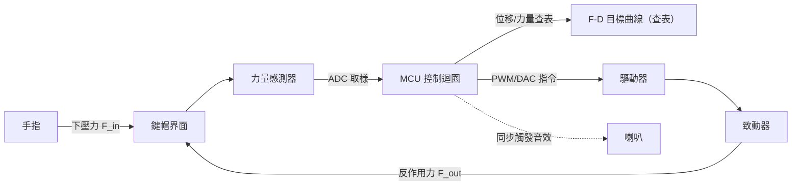

> 本文由 2025-11-28 的 HackMD 筆記（標題 *Recreating the 'Tactile Bump': Haptic Rendering*，僅大綱與系統草圖）於 2026-10-28 擴寫而成。原理與文獻段落是擴寫時補查的，證據等級如實標註；原稿首圖已失效，故全文不含圖片。

螢幕上按鍵最大的問題不是看不到，而是按下去「什麼都沒發生」。實體按鍵的段落感——那個先頂住、突然垮掉、再放行的手感——來自機構本身，而不是韌體。想在一塊平板或一顆虛擬按鍵上重現它，問題就變成：**這個手感到底是哪一段物理？能不能用致動器渲染出來？**

## 一、原理：Snap-Through Buckling 與雙穩態勢能

先把術語立好，避免後面概念漂移。

**Snap-through buckling（穿越挫曲）**是一種結構失穩：帶弧度的薄殼、拱或金屬彈片受壓時，位移越過臨界點，結構不再沿原變形路徑走，而是「啪」一聲翻到另一個形狀。金屬 dome（彈片按鍵）就是工業上最常見的應用：按壓時 dome 從凸翻成凹，這個翻轉就是段落感的來源。這類問題的經典模型是 **von Mises truss**——兩根斜撐彈簧撐住一個節點、受垂直負載的雙穩態結構，名稱來自 von Mises 1923 年對彈性體穩定問題的分析（此處憑二手文獻確認，沒翻原典）。

用勢能曲線看最清楚。一個雙穩態系統的勢能可以寫成：

$$U(x)=\tfrac{1}{4}ax^{4}-\tfrac{1}{2}bx^{2},\quad a,b>0$$

反作用力是勢能的負梯度：

$$F(x)=-\frac{dU}{dx}=-ax^{3}+bx$$

這條 $$F(x)$$ 有兩個穩定平衡點（$$x=\pm\sqrt{b/a}$$，勢能兩個井）夾著一個不穩定點（$$x=0$$，勢能山頂）。按壓過程就是推著系統翻過山頂：在山頂附近 $$dF/dx<0$$，這就是**負剛性區段**——位移增加、反力反而下降，結構無法在此區段維持穩定平衡，於是瞬間從一個井跳到另一個井。手指感受到的「段落」，正是這段力崩落的瞬間。

對應到按鍵規格書的 force-displacement（F-D）曲線：力量先爬升到峰值 $$F_{\text{peak}}$$（trip force），翻轉瞬間崩落到谷底 $$F_{\text{valley}}$$（release force）。業界常用 **snap ratio / click ratio** 量化段落感：

$$R_c=\frac{F_{\text{peak}}-F_{\text{valley}}}{F_{\text{peak}}}\times 100\%$$

這裡誠實標註證據等級：原稿筆記寫「Snap Ratio > 40% 才夠脆」，但那是憑印象的門檻；查到的工程文獻（Liu & Lin 2018，以有限元素分析彈片 snap-through 行為）給的設計建議是 **30%–60%**——太小沒感覺，太大易有塑性變形與不良表現。兩者不衝突，但 40% 不是硬標準。ASTM F2592 也以 F-D 曲線定義 tactile switch 的量測方法。另外按人力工學，行動產品的 $$F_{\text{peak}}$$ 常設計在 1–2.8 N。

**渲染端的學術脈絡**：Kim & Lee 的 UIST '13 論文提出沿 F-D 曲線為虛擬按鍵設計觸覺回饋——不只渲染 click 那一瞬間，還涵蓋曲線上前後移動段的感覺，且全程只用振動刺激、不需要真正的力回饋機構。Liao 等人的 UIST '18（Button Simulator）則反過來：用 3D 列印做出一支能重現**任意** F-D 曲線的低成本實體按鍵，平均誤差約 0.034 N，且開源。但單靠一條 F-D 曲線並不完備——後續研究（FDVV 模型，CHI EA 2020）指出按鍵本質是 spring-mass-damper 系統，反力同時依賴**速度**，只查一維位移曲線會失真。這是所有「查表渲染」路線的理論上限。

## 二、實作：重現 F-D 曲線的閉環架構

原理講完，接著是怎麼把它做出來。思路很直觀：**感測手指的輸入 → 查目標曲線 → 算出要補的力差 → 交給致動器**，整個迴圈跑在 1 kHz 級的取樣率上。

### 2.1 系統總覽



### 2.2 控制迴圈：力差補償

核心是一個極簡的迴圈——目標曲線減掉機構本身的被動彈簧力，剩下的差額就是致動器要補的：

```c
/* 1 kHz 控制迴圈：以力差補償重現 F-D 曲線 */
for (;;) {
    float x = read_displacement();            // 位移（或由力量積分估計）

    float f_target  = lut_lookup(&fd_curve, x); // 查表：目標反作用力
    float f_passive = K_MECH * x;               // 機構本身的線性彈簧力
    float f_err     = f_target - f_passive;     // 致動器要補的力差

    dac_write(clip(f_err / G_VCA));             // 電流指令 → 反作用力

    if (crossed_valley(prev_x, x)) {            // 剛過 F_valley 點
        trigger_snap();                         // 加速力下降 + 同步音效
    }
    prev_x = x;
    wait_interrupt(TICK_1MS);
}
```

兩個容易踩的坑：一是 `lut_lookup` 之前先把曲線**去抖與內插**，離散點之間線性內插就夠，但別讓相鄰取樣跳變（會變成觸發器雜音）；二是 `crossed_valley` 要用**狀態機**（未過峰 → 過峰 → 過谷）而不是單點比較，否則手指在谷底附近抖動時會連續誤觸發 snap。

### 2.3 致動器選擇：Piezo vs LRA

這是整個系統最大的取捨點，我的結論先講：**要「脆」就用壓電，要省電省錢就用 LRA，但 LRA 裝不出 snap-through 的瞬間崩落感。**

| 致動器 | 響應速度 | 特性 |
| --- | --- | --- |
| 壓電（PZT） | < 1 ms 級 | 可自訂任意波形、頻寬高；需要上百伏特高壓驅動 |
| LRA | 約 10 ms 級 | 諧振式，省電但波形受諧振頻率綁定 |
| ERM | 約 100 ms 級 | 轉子慣量大，只適合「嗡」的鈍感 |

（響應數字取自 TDK PiezoHapt 應用筆記的對比量測；TI 的應用報告給的 piezo 啟動時間約 14 ms、ERM 50–100 ms——量測條件不同，數字有出入，但排序一致：piezo ≪ LRA < ERM。）

壓電的痛點是驅動電壓：要打到 100 V 級才有力。實務上我會看 Boréas 的 BOS1901 這類 CapDrive 晶片——單晶片壓電驅動器，從 3–5.5 V 電源打出 190 Vpk-pk，靠電荷回收把功耗壓下來（100 nF 負載、190 Vpp、300 Hz 下約 350 mW），啟動時間 < 300 µs。它最巧的一點是 **piezo 兼作感測器**：驅動器可以回查致動器電壓來感測受力（原稿筆記寫的 CapDrive「感測與致動共用」就是這個）——同一顆壓電片既是馬達又是力量計，閉環省掉一顆 FSR，只是感測解析度別期待能跟專用感測器比。

另一個關鍵是**主動剎車（active braking）**：壓電片是低阻尼的諧振體，敲完一個脈衝會自己振鈴，聽起來像蜂鳴器而不是按鍵。做法是在主脈衝後緊接一個反相的衰減驅動，把餘振吃掉。這一步做不做，是「高級觸感」與「廉價 buzzer」的分水嶺。

### 2.4 沒有真力回饋時：振動近似路線

如果做不起音圈級的力回饋（體積、成本、安全），退而求其次是純振動近似：把 F-D 曲線轉成壓電致動器的振幅包絡，在過谷點之後插入一個衰減振鈴模擬 dome 落底的加速度脈衝：

```python
# vibrotactile 近似：F-D 曲線 → 壓電振幅包絡
for i, x in enumerate(np.linspace(0, TRAVEL, STEPS)):
    f_t = curve(x)                       # 目標反作用力
    envelope[i] = 1.0 - f_t / F_PEAK     # 力掉得越深，振幅越「空」
ring = exp_decay_pulse(t_snap)           # 過谷後的衰減脈衝
```

這條路線就是 UIST '13 那篇的做法：嚴格說它騙不了你的力覺，但 timing 對了，體感就是「按到了」。人因實驗也支持延遲是命門——回饋延遲超過約 85 ms，主觀評價就明顯下滑，這也是為什麼 2.2 的迴圈要壓在 1 kHz 級。

### 2.5 誠實評價

這個架構我沒有完整搭過硬體，原稿也只是系統草圖，所以以上是**設計推演**而非實測報告。憑推演判斷：最難的不是查表也不是驅動，而是**感測品質與延遲**——FSR 的非線性與蠕變、壓電感測的解析度，會直接決定渲染出來的曲線是「脆」還是「糊」；而 2.4 路線的理論上限（力也依賴速度）是結構性的，補不回來。如果只是想驗證手感，建議直接複刻 UIST '18 的 Button Simulator，開源、3D 列印、誤差 0.034 N，比從零調 PID 快得多。

## 延伸閱讀

- Sunjun Kim, Geehyuk Lee (2013). *Haptic feedback design for a virtual button along force-displacement curves.* UIST '13, pp. 91–96. [DOI: 10.1145/2501988.2502041](https://dl.acm.org/doi/10.1145/2501988.2502041)
- Yi-Chi Liao, Sunjun Kim, Antti Oulasvirta (2018). *One Button to Rule Them All: Rendering Arbitrary Force-Displacement Curves.* UIST '18 Adjunct, pp. 111–113. [DOI: 10.1145/3266037.3266118](https://dl.acm.org/doi/10.1145/3266037.3266118)；[專案頁（Aalto）](https://userinterfaces.aalto.fi/button-simulator/)
- Thomas Jin-Chee Liu, Nai-Pin Lin (2018). *Snap-Through Behavior of Arch Shell for Button or Switch Design in Electronic Products.* JIIAE 6(4), 156–164. [DOI: 10.12792/jiiae.6.156](https://doi.org/10.12792/jiiae.6.156)（click ratio 30–60% 設計建議、F_peak 1–2.8 N）
- *Press'Em: Simulating Varying Button Tactility via FDVV Models.* CHI EA 2020. [arXiv: 2002.12315](https://arxiv.org/abs/2002.12315)（F-D 單曲線模型的速度依賴批評與 FDVV 模型）
- [Boréas BOS1901 CapDrive 壓電驅動器](https://boreas.ca/products/bos1901-piezo-haptic-driver)（190 Vpk-pk、piezo force sensing、能量回收）
- Jani Lylykangas et al. (2011). *Designing tactile feedback for piezo buttons.* CHI '11. [DOI: 10.1145/1978942.1979428](https://dl.acm.org/doi/10.1145/1978942.1979428)（回饋延遲逾 85 ms 主觀偏好下滑的實驗）
- [TDK PiezoHapt 應用筆記](https://product.tdk.com/en/products/sw_piezo/haptic/piezohapt/application_note)（piezo/LRA/ERM 響應速度對比）
- [TI: High-definition haptics (slyt483)](https://www.ti.com/lit/an/slyt483/slyt483.pdf)（各致動器啟動時間量測）
